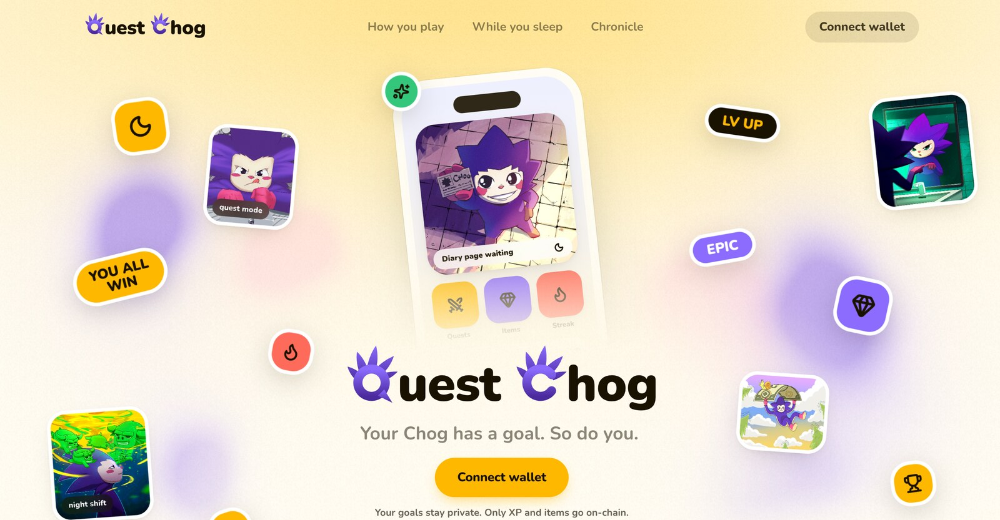

<p align="center">
  
</p>

<h1 align="center">Quest Chog</h1>

<p align="center">
  <strong>Your Chog has a goal. So do you.</strong><br>
  You complete yours, it completes its, you all win.
</p>

<p align="center">
  <a href="https://questchog.onrender.com"><strong>Play: questchog.onrender.com</strong></a>
  ·
  <a href="https://monadscan.com/address/0xB46cd62a826b94f07a507c5359F79F189200ec93">Chronicle on Monad</a>
  ·
  <a href="https://chogathon.chog.xyz">Chogathon 2026</a>
</p>



Your private goals become RPG quests. Your Chog NFT is your party member. Each night it goes out and comes back with a diary page and up to three items. XP, level, streak and items are recorded on Monad against the Chog's **token ID** in the Chronicle contract, so they follow the NFT if it changes wallets.

Built for Chogathon 2026.

## How you play

1. **Claim your Chog.** Connect the wallet that holds it and sign in (a free signature).
2. **Set your goals.** Up to three. They are encrypted and never go on-chain. Your Chog gets its own quest.
3. **Check in. Level up.** Each check-in is +60 XP and moves your Chog's quest too. Claim last night's items for +40 XP before the end of the next day (UTC), or they slip into Lost and Found.

## What is in this repo

| Path | What |
| --- | --- |
| `app/` | Next.js 16 app: landing, `/start`, `/app` (Today, Quests, Chog, Share), `/link`, and all `/api/*` routes |
| `lib/xp.ts`, `lib/night.ts`, `lib/items.ts` | Deterministic game rules: XP, levels, streak with weekly sleep-in, night rolls (about 1 in 12 nights has an EPIC item) |
| `lib/narrate.ts` | The only AI call (Nebius Token Factory). It writes the diary title and text from the roll. It never decides numbers |
| `lib/game.ts` | Goals, check-ins, nights, claims, app state |
| `lib/chain.ts` | Read-only chain access: Chog NFT (`ownerOf`, `tokenURI`), Chronicle's item roll, and claim verification |
| `lib/bot.ts`, `app/api/telegram` | Telegram bot: link with `/start CODE`, then Claim and Mute buttons on the evening nudge |
| `lib/cron.ts` | Evening job: one Telegram nudge per linked player when tonight's items are unclaimed |
| `neon.ts`, `functions/scheduler.ts` | Neon backend: Postgres and the scheduler Function with its evening trigger |
| `contracts/` | Foundry project with `Chronicle.sol`, 21 tests, deploy script |
| `scripts/smoke.ts` | End-to-end check of the API with a real wallet key |
| `lib/config.ts` | Public settings: Monad mainnet RPC and explorer, Chog NFT and Chronicle addresses, Telegram bot username, Nebius endpoint and model |
| `render.yaml` | Render Blueprint for the web service and its env group (secrets only) |

## Trust model

- **No keys on the server.** The Chog's holder claims each night from their own wallet. Chronicle checks `ownerOf` on the Chog Genesis NFT itself (both on Monad mainnet), rolls the night's items on-chain from `(tokenId, day)`, and records them. The server only reads the chain: it shows the same roll on the diary page, then verifies the claim transaction's `NightClaimed` event before mirroring it into the app.
- Chronicle allows one claim per Chog per day, for today or yesterday only (`DayNotClaimable`, `AlreadyClaimed`). Progress belongs to the token ID, so it follows the Chog to a new wallet. The owner can pause claims.
- Claims cost the player a little MON for gas (about 0.02 MON per claim).
- Goal titles and check-in notes are AES-256-GCM encrypted at rest and never logged. On-chain: claim XP, level, streak and item IDs. Check-in and quest XP stay in the app. Share cards hide goal names by default. "Delete my data" removes goals and check-ins.

## Local development

Needs Bun 1.3+, Postgres, and Foundry for the contracts.

```bash
bun install
createdb questchog
cp .env.example .env.local      # fill in the values
bun run db:migrate
bun dev                         # http://localhost:3000
```

Contracts:

```bash
cd contracts
forge test
```

### Full local run on anvil

```bash
anvil
cd contracts && forge create src/Chronicle.sol:Chronicle --rpc-url http://127.0.0.1:8545 \
  --private-key <deployer key> --broadcast --constructor-args <owner> <an ERC-721 you hold>
```

Contract addresses live in `lib/config.ts`. For a local chain only, point the app at it with `DEV_MONAD_RPC_URL=http://127.0.0.1:8545`, `DEV_CHRONICLE_ADDRESS` and `DEV_CHOG_NFT_ADDRESS`, then:

```bash
BASE_URL=http://localhost:3000 SMOKE_PRIVATE_KEY=<holder key> SMOKE_TOKEN_ID=<id> bun run smoke
```

The smoke test signs in, rejects a Chog the wallet doesn't hold, creates a goal, checks in, rejects a second check-in, claims the night on-chain from the holder's wallet, rejects a second claim the same day, and deletes the data.

## Deploying

### 1. Chronicle on Monad

Deployed on **Monad mainnet** (chain 143). It reads the real [Chog Genesis](https://monadscan.com/address/0xc96d31F8626c6D03Fae5dCD3d61e3FB9F4a73763) collection (1,969 Chogs), so any Chog holder can play.

| | |
| --- | --- |
| Chronicle contract | [`0xB46cd62a826b94f07a507c5359F79F189200ec93`](https://monadscan.com/address/0xB46cd62a826b94f07a507c5359F79F189200ec93) |
| Deploy transaction | [`0x6474bd30…feef4b`](https://monadscan.com/tx/0x6474bd30c171e7200e670f4fec7972eaac4276e6fa1afa30d4cf32dda2feef4b) (block 115,792,506) |
| Owner (can pause) | [`0xE712a13CFA3220B9b1Ea5f7bd6e77CAd44F5B826`](https://monadscan.com/address/0xE712a13CFA3220B9b1Ea5f7bd6e77CAd44F5B826) |

The app always uses these addresses from `lib/config.ts`; no env var is needed. Earlier testnet deployments on chain 10143 are unused. The mainnet Chronicle shares its address with the paused signer-based testnet one only because both were the deployer's first transaction on their chain.

```bash
cd contracts
export DEPLOYER_PRIVATE_KEY=0x...      # only for deploying; the app never needs it
forge script script/Deploy.s.sol:Deploy --rpc-url monad --broadcast
```

### 2. Neon (database and scheduler)

`neon.ts` declares the backend on Neon: Lakebase Postgres and a `scheduler` Function with one Function Trigger (`0 19 * * *` UTC). The scheduler verifies each delivery came from Neon, then calls `APP_URL/api/cron/evening` with `x-cron-secret`. Diary pages are generated when a player opens the app, or by the evening job.

```bash
neon login
neon deploy --env .env.local     # provisions services, deploys the function, pulls DATABASE_URL
bun run db:migrate               # direct connection, derived from DATABASE_URL
```

The app uses the pooled `DATABASE_URL` with `postgres.js` (prepared statements off for PgBouncer). AI narration is optional: with a `NEBIUS_API_KEY` the diary is written by `Qwen/Qwen3.5-397B-A17B` on Nebius Token Factory (endpoint and model in `lib/config.ts`), otherwise the built-in template writes it.

### 3. Render (web app)

1. Push the repo and create a Blueprint from `render.yaml`. It runs one web service in Ohio, next to the Neon project in `aws-us-east-2`.
2. Fill in the two required values: the Neon `DATABASE_URL`, and `CRON_SECRET` (the same value the Neon scheduler was deployed with). Telegram and AI values are optional. Public settings, including the bot username, go in `lib/config.ts`, not env.
3. Set `APP_URL` in `.env.local` to the Render URL and run `neon deploy --env .env.local` again so the scheduler calls it.
4. Register the bot webhook once, if you use Telegram:

```bash
TELEGRAM_BOT_TOKEN=... TELEGRAM_WEBHOOK_SECRET=<value from Render> APP_URL=https://... bun scripts/set-webhook.ts
```

Notes from Render's docs (October 2026): a Free web service spins down after 15 minutes without traffic, which makes the first bot reply slow, so the Blueprint uses the Starter plan. Check current pricing before you deploy.

## Testing instructions for judges

1. Open https://questchog.onrender.com and press **Connect wallet**.
2. Connect a wallet that holds a Chog Genesis NFT on Monad mainnet and a little MON for gas, then sign the free sign-in message.
3. Pick your Chog and set a first goal.
4. On **Today**, read last night's diary, press **CLAIM** and confirm in your wallet. XP goes up and the transaction links to the explorer.
5. Check in on your goal. Your Chog's quest moves too.
6. **Chog** shows the inventory recorded against the token ID. **Share** saves cards as images.
7. Optional: on **Chog**, press **LINK TELEGRAM**, then **OPEN TELEGRAM** and press Start. In the evening the bot sends one message with a button that opens the app to claim.

$CHOG is never required to play.
